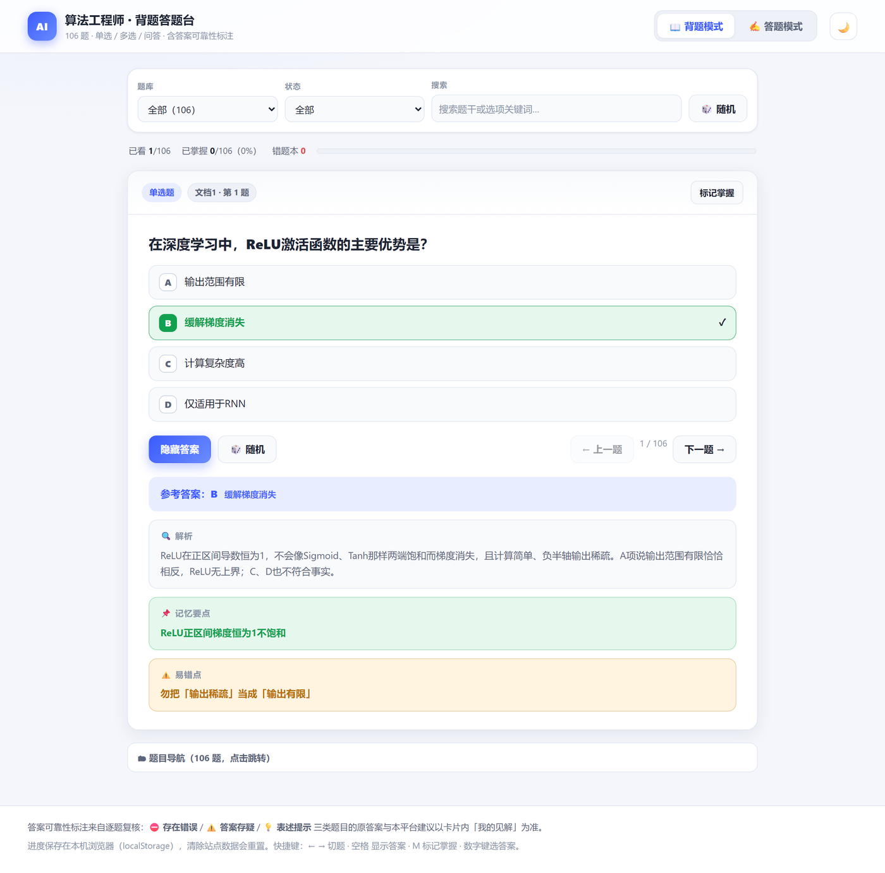
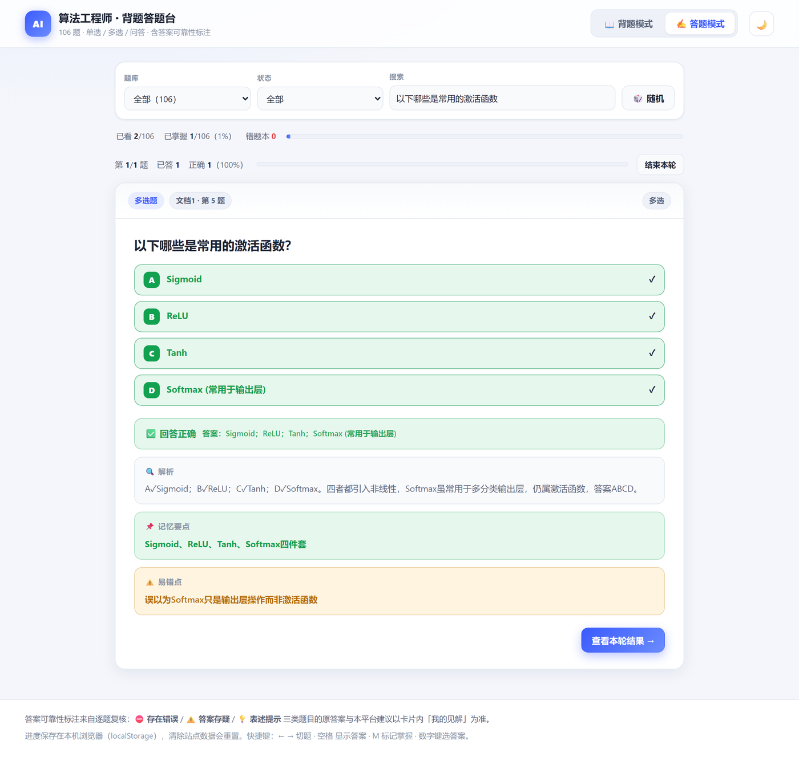
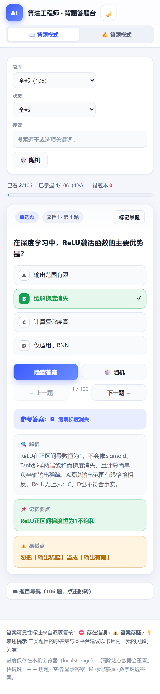
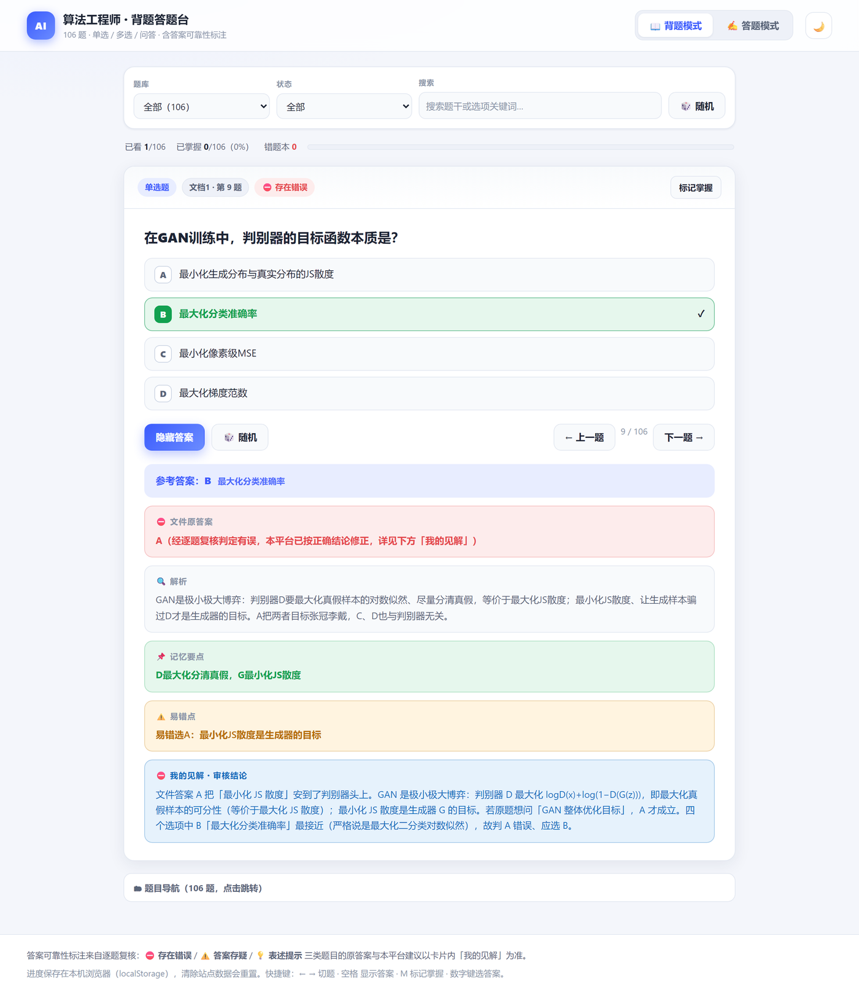

# AI 算法工程师 · 背题答题台

把两份 docx 题库（《人工智能算法工程师题库》《人工智能系列实操题库》，共 **106 题**）做成的静态刷题网站，纯 HTML/CSS/JS、零依赖，可直接部署到 **GitHub Pages**。

> 所有题目的答案都经过逐题复核：其中 **2 题原答案有误**（已修正并在卡片中标注）、**8 题答案存疑**、**2 题表述提示**。这些题目的「我的见解 · 审核结论」会随答案一起展示，帮你记住"为什么"和"坑在哪"。



| 答题模式（选中后立即给出解析） | 移动端 |
|---|---|
|  |  |

## 功能

- **背题模式**：默认直接显示答案，按「空格」或按钮可隐藏/显示；显隐状态在切题、换筛选时保持不变，并记住上次选择。答案区展开「解析 → 记忆要点 → 易错点 → 我的见解」，可标记「已掌握」，支持题目导航网格、随机跳题。
- **答题模式**：按当前筛选范围抽题（10 / 20 / 全部），单选点击即判分，多选勾选后提交，问答题自答后显示参考答案并自评；答完立即展开同一套辅助信息。
- **进度记忆**：已看 / 已掌握 / 错题本存在浏览器 localStorage；答对的题自动记为已掌握并移出错题本，答错自动入错题本，可「只练错题」「重做本轮错题」。
- **筛选**：按文档、掌握状态、错题本、有标注题目筛选，支持题干/选项关键词搜索。
- **键盘操作**：`←/→` 切题，`空格` 隐藏/显示答案，`M` 标记掌握，数字键选答案，`Enter` 下一题。
- 深色模式、移动端适配，无任何外部依赖（离线可用，直接双击 `index.html` 也能打开）。

## 目录结构

```
.
├── index.html                 # 页面入口
├── assets/
│   ├── style.css              # 样式（深色主题、响应式）
│   └── app.js                 # 背题/答题逻辑、判分、localStorage 进度
├── data/
│   ├── questions.js           # 运行时数据（由构建脚本生成，页面直接加载）
│   ├── raw.json               # docx 解析出的原始题目（构建用）
│   ├── flags.json             # 逐题审核标注 + 「我的见解」（构建用）
│   └── explain_*.json         # 解析 / 记忆要点 / 易错点（构建用）
├── scripts/
│   ├── build_raw.py           # docx 文本 -> raw.json（可选，需要 q1.txt/q2.txt）
│   └── build_data.py          # 合并校验 -> questions.js
├── screenshots/               # README 配图
├── .nojekyll                  # 关闭 GitHub Pages 的 Jekyll 处理
└── README.md
```

> 运行时只需要 `index.html + assets/ + data/questions.js`；`raw.json / flags.json / explain_*.json / scripts/` 是重新生成数据的源文件，保留不影响部署。

## 部署到 GitHub Pages

1. 新建一个 GitHub 仓库（例如 `ai-exam-quiz`）。
2. 把**本目录里的全部内容**复制到仓库根目录（不是把本文件夹本身放进去）。
3. 提交并推送：
   ```bash
   git init
   git add .
   git commit -m "AI exam quiz site"
   git branch -M main
   git remote add origin https://github.com/<你的用户名>/ai-exam-quiz.git
   git push -u origin main
   ```
4. 打开仓库 **Settings → Pages**：Source 选 **Deploy from a branch**，Branch 选 `main`、目录选 `/ (root)`，Save。
5. 等 1–2 分钟，访问 `https://<你的用户名>.github.io/ai-exam-quiz/`。

> 如果希望仓库里同时保留 docx 原件和审核报告，可把本目录内容放进 `docs/`，Pages 目录改选 `/docs`。
> 私有仓库需 GitHub Pro 才能开启 Pages；公开仓库免费。

## 本地预览

```bash
cd site
python -m http.server 8000
# 浏览器打开 http://localhost:8000
```
（直接双击 `index.html` 也能用，因为数据是 JS 文件而不是 fetch JSON。）

## 修改 / 扩充题库

1. 题目文本改 `data/raw.json`（字段：`id/type/book/section/num/stem/options/answer`，`type` 取 `single|multi|qa`）。
   若有 docx 转出的纯文本 `q1.txt / q2.txt`，也可以先跑 `python scripts/build_raw.py` 重新解析。
2. 在 `data/explain_*.json` 中补该题的 `explain / tip / pitfall`；争议题在 `data/flags.json` 里加 `status`（`error|doubt|borderline`）、`accept`（可接受答案集合，多选写成 `"AB"` 这类排序后字符串）与 `insight`。
3. 重新生成并校验：
   ```bash
   python scripts/build_data.py
   # 会输出总数/分节/状态统计，若有缺解析、答案越界等会直接报错退出
   ```

## 答案可靠性标注说明

| 标注 | 含义 | 平台处理方式 |
|---|---|---|
| ⛔ 存在错误 | 原答案事实/方向错误 | 已改用正确结论，并展示「文件原答案」与修正说明 |
| ⚠️ 答案存疑 | 答案过窄、选项无唯一解或定义口径不一 | 保留原答案为判分基准，同时接受更严谨的答案；展示见解 |
| 💡 表述提示 | 答案方向正确但表述不严谨 | 展示更准确的表述建议 |
| 无标注 | 复核确认正确 | — |

被判为错误/存疑的题目及完整理由，见每道题的「我的见解 · 审核结论」：


